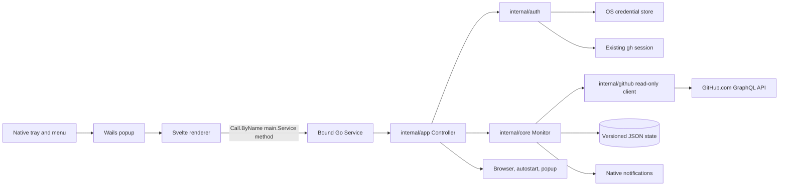

# Architecture

## Components

- `main.go`, `service.go`, and `native.go` create the Wails tray app, window, OS integrations, and the renderer's narrow application API.
- `internal/app` coordinates settings, authentication changes, validated browser opening, refresh control, and platform actions without depending on Wails.
- `internal/auth` validates credentials and reads/writes secrets through the native credential store or the existing GitHub CLI session.
- `internal/github` issues read-only GitHub GraphQL queries, handles bounded pagination and team discovery, and normalizes PR, approval, and status-check data.
- `internal/core` polls, retains the last good snapshot during failures, manages per-PR bells, tracks notification transitions, and schedules local notifications.
- `internal/storage` stores versioned settings and notification state as separate atomic JSON files.
- `internal/model` defines the non-secret snapshot and settings contract shared by the backend and UI.
- `internal/websecurity` supplies the Content Security Policy and filters the Wails runtime surface.
- `frontend` contains the Svelte/TypeScript popup and settings. Browser fixtures are enabled only through test/development flags; they are not embedded into production assets.

## Data flow

The UI calls explicit methods such as `GetSnapshot`, `SaveSettings`, `ConnectPAT`, `ConnectCLI`, `SetBell`, `SetLayout`, `Refresh`, `OpenPR`, and `HidePopup`. It uses Wails runtime `Call.ByName`; generated binding files are not required. No raw API client, generic command execution or filesystem operation is exposed. Stored tokens are never returned to the renderer. The user-entered PAT is passed directly to ConnectPAT and cleared from the input before awaiting the result. The GitHub client is a Go HTTP client and accepts only the production GitHub endpoint except for loopback endpoints injected by tests.

`SaveSettings` accepts non-authentication preferences only. Authentication method/account values are changed by `ConnectCLI` or validated `ConnectPAT`. PAT validation precedes credential replacement; the token is cleared from the app operation and never returned to the snapshot. PAT storage errors do not trigger another storage mechanism.

## State and notification lifecycle

Settings store account metadata, method, interval, layout, event preferences, global notifications, and launch-at-login. State stores the current account key, PR bell flags, and last-observed notification fields. The initial successful fetch establishes a baseline before any historical transition notification is considered. Each later successful fetch saves the new baseline atomically before dispatching notifications. Failed fetches do not advance the baseline and leave cached rows visible.

Review-request false-to-true edges can notify without a bell; other changes need a bell. Overlapping category membership is deduplicated by GitHub PR node ID. The UI snapshot omits internal review-request IDs used by the Go monitor to recognize a newly recreated request. Notification baselines provide at-most-once attempts, not guaranteed delivery: an OS failure after the baseline write may drop a notification.

## Renderer and production boundary

Wails embeds `frontend/dist`; production builds do not fetch application code from the network. `internal/websecurity.Middleware` sets a restrictive CSP and allows only the minimal Wails runtime binding operations needed by the app. The API is served through Wails' webview transport, not a separate application server.

`scripts/package.sh` and `scripts/package-windows.ps1` build with `-tags production`. The production build disables development preview. `production_guard.go` makes a production build with `mcp`, `devtools`, or `server` tags fail to compile. MCP support is limited to an explicitly tagged development build, and its CSP may allow only the configured loopback callback port. Browser fixtures are gated from production builds.

## Platform adapters and limits

Wails provides tray, popup, browser, autostart, and notification integrations. `go-keyring` maps credentials to macOS Keychain, Windows Credential Manager, and Linux Secret Service. The Linux package depends on system GTK4/WebKitGTK 6; Wails smoke coverage does not establish identical tray behavior across every desktop environment. Authentication, GitHub state, and notifications are sampled/polled; transient changes between samples are unobservable. See [SECURITY.md](SECURITY.md) for security assumptions and remaining risks.
