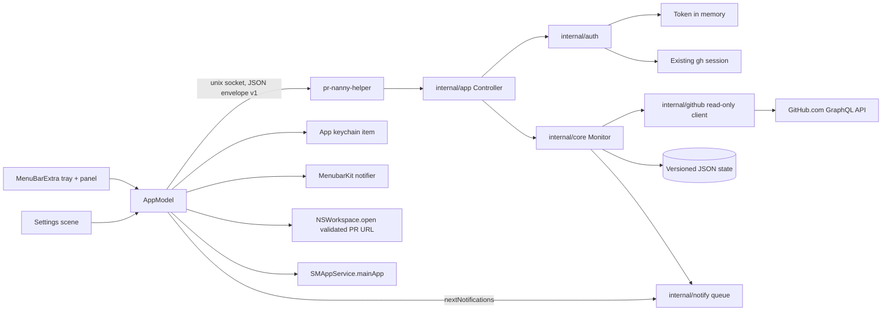

# Architecture

PR Nanny is two processes in one app bundle: a native Swift menu-bar app (`PR Nanny.app/Contents/MacOS/PRNanny`) and the Go backend it supervises (`Contents/Helpers/pr-nanny-helper`). They talk over a private unix socket.

## Components

- `macos/` — Swift package. `PRNannyNative` (library) holds the helper client, supervisor policy, models, presentation and settings rules, URL validation and notification mapping; it is what the Swift tests cover. `PRNanny` (app target) is SwiftUI glue: `MenuBarExtra` tray label and 340pt panel, the Settings scene, notification posting and launch at login. Tray, panel and notification building blocks come from [`alexcatdad/menubar-kit`](https://github.com/alexcatdad/menubar-kit), pinned by revision.
- `cmd/pr-nanny-helper` runs the backend and serves it over a private unix socket (`internal/helper`, see [docs/HELPER-API.md](docs/HELPER-API.md)).
- `internal/app` coordinates settings, authentication changes, PR URL resolution, notification gating and refresh control without depending on any UI.
- `internal/auth` validates credentials and holds a PAT in memory only, or reads the existing GitHub CLI session per fetch. The app keeps the PAT in its keychain item and hands it over the socket at startup; `go-keyring` is used only to migrate and delete the PR Nanny 0.1.x item.
- `internal/github` issues read-only GitHub GraphQL queries, handles bounded pagination and team discovery, and normalizes PR, approval, and status-check data.
- `internal/core` polls, retains the last good snapshot during failures, manages per-PR bells and tracks notification transitions.
- `internal/storage` stores versioned settings and notification state as separate atomic JSON files and holds the single-instance lock.
- `internal/notify` holds the bounded notification queue the app reads by cursor.
- `internal/model` defines the non-secret snapshot and settings contract shared by the helper and the app.

## Data flow

The app starts the helper as a child process at launch (`HelperSupervisor`); the helper exits when the app does. A helper crash restarts with exponential backoff (1–30 s, six attempts); exit status 3 means another PR Nanny holds the instance lock and is not retried. Development bundles (`com.alexcatdad.pr-nanny.dev`) pass `-data-dir ~/Library/Application Support/pr-nanny-dev` so they never contend with an installed app.

The app reads cached snapshots only (`snapshot`): every second while a refresh runs, every 5 seconds while the panel is open, every 30 seconds otherwise. These are local socket reads; only the Refresh button (`refresh`), account connections and the helper's own interval reach the GitHub API, so the polling budget in [docs/API-COST.md](docs/API-COST.md) is unchanged. Actions (`setBell`, `setLayout`, `saveSettings`, `connectPAT`, `connectCLI`) return a snapshot that wins over any read still in flight.

`saveSettings` accepts non-authentication preferences only. Authentication method and account change through `connectCLI` or a validated `connectPAT`. The PAT field is cleared before the call returns; the token is never returned in a snapshot. Stored tokens never reach the Swift process.

`VERSION` is the SemVer source of development builds; local releases pass `RELEASE_VERSION`. Packaging embeds it in the helper (`-version`) and the bundle's Info.plist.

## State and notification lifecycle

Settings store account metadata, method, interval, layout, event preferences, global notifications, and the launch-at-login preference. State stores the current account key, PR bell flags, and last-observed notification fields. The initial successful fetch establishes a baseline before any historical transition notification is considered. Each later successful fetch saves the new baseline atomically before queuing notifications. Failed fetches do not advance the baseline and leave cached rows visible.

Review-request false-to-true edges can notify without a bell; other changes need a bell. Overlapping category membership is deduplicated by GitHub PR node ID. The snapshot omits internal review-request IDs used by the Go monitor to recognize a newly recreated request.

The helper queues every event (newest 64) and gates it when the app reads it: global switch, then that event's preference, then the PR's bell. The app polls `nextNotifications` every 10 seconds and posts each entry through MenubarKit's `MenubarNotifier`: only while the user's **Allow notifications** toggle is on (off by default), only with macOS permission (requested from that toggle), silent unless **Play a sound** is on. The sha256 dedupe ID is the notification identifier, so repeats coalesce; the PR node ID is the thread identifier, so a click resolves the PR through `resolvePR` even after a relaunch. Delivery is at-most-once: an entry read while notifications are off or unauthorized is consumed.

## UI boundary

All GitHub-supplied text (titles, repository names, account, helper messages) is rendered with SwiftUI `Text(verbatim:)` or plain `String` initializers, never as Markdown or HTML. PR URLs are validated twice: the helper replies to `resolvePR` only with a `ValidPRURL` URL, and `PRURL.isValid` (a stricter Swift mirror) checks again before `NSWorkspace.open`.

Launch at login uses `SMAppService.mainApp`; the toggle reflects the service's real status and also records the preference in the helper's settings.

## Platform limits

Authentication, GitHub state and notifications are sampled/polled; transient changes between samples are unobservable. See [SECURITY.md](SECURITY.md) for security assumptions and remaining risks.
