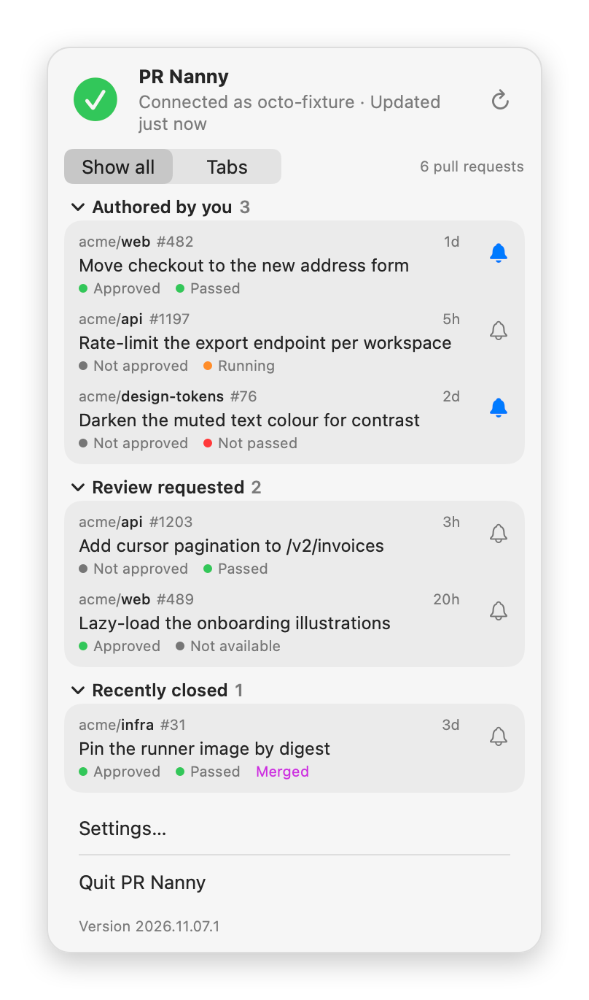
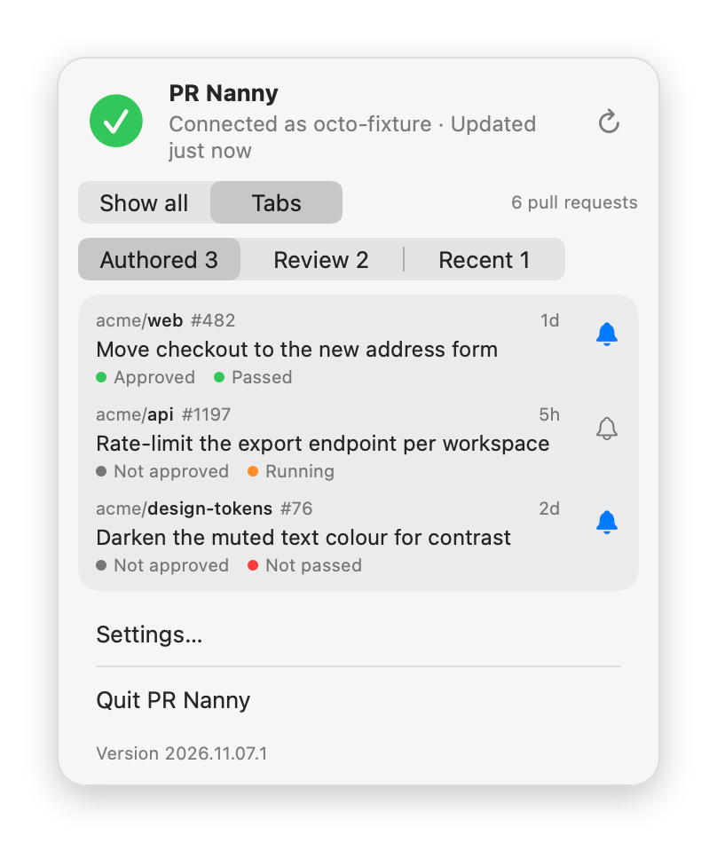
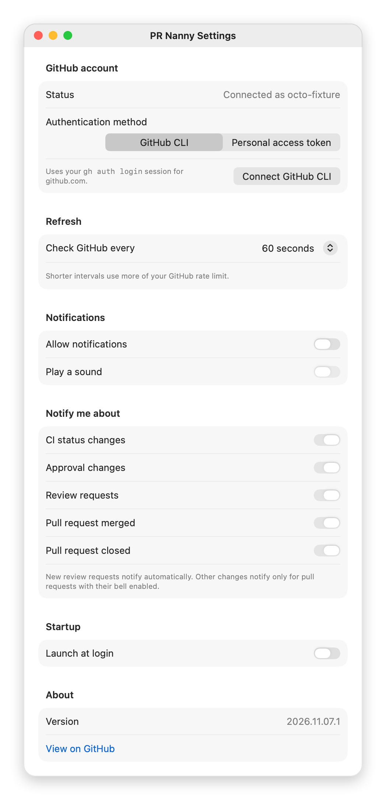
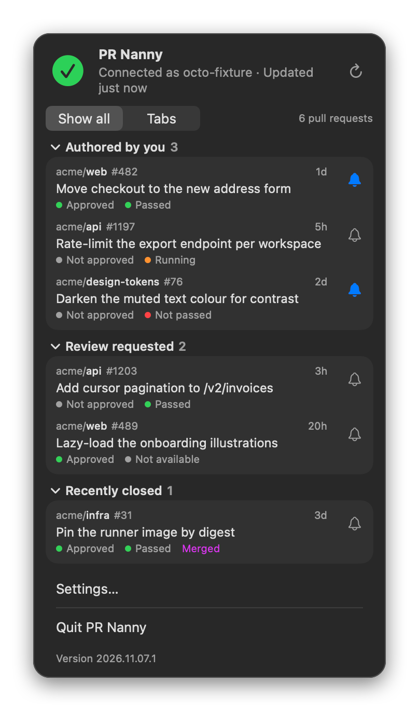
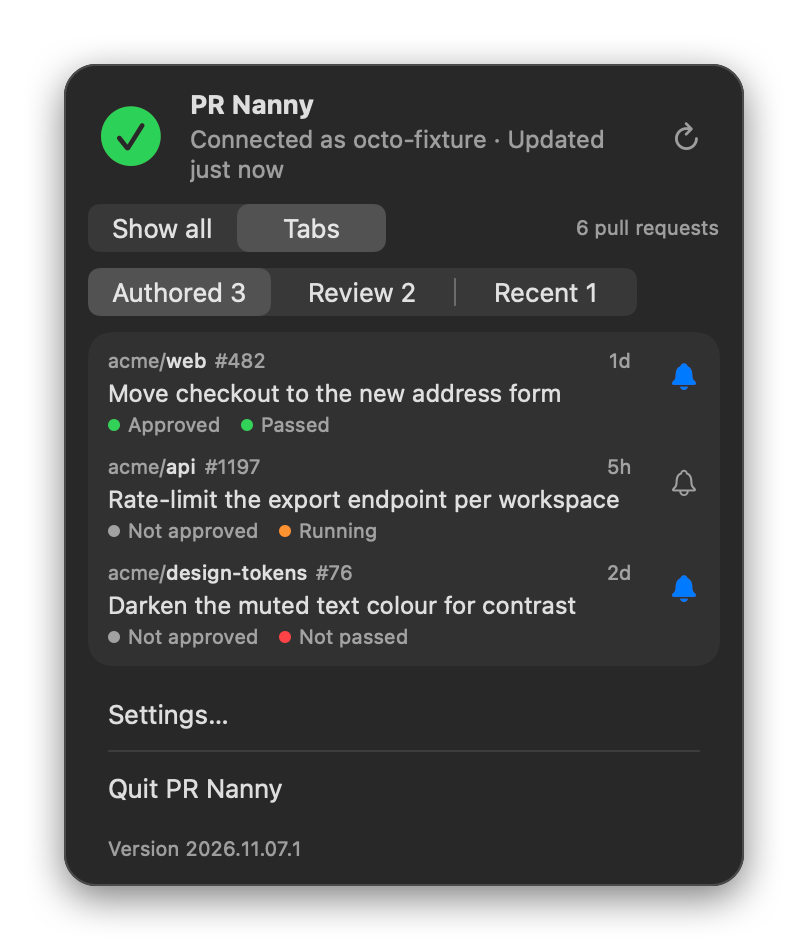
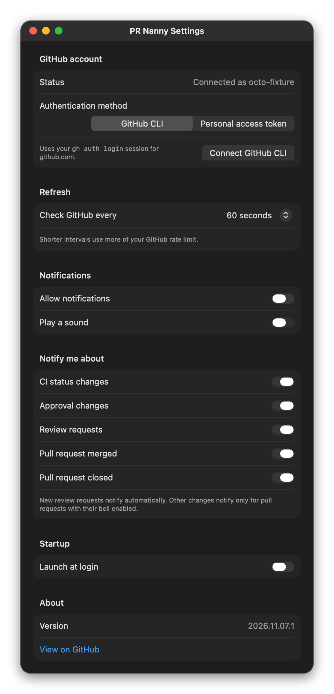

# PR Nanny

[](https://github.com/alexcatdad/pr-nanny/actions/workflows/validation.yml) [](https://github.com/alexcatdad/pr-nanny/releases) [](LICENSE)

PR Nanny is a passive GitHub.com pull-request monitor that lives in the macOS menu bar. It reads open pull requests authored by you or requesting your individual or team review, shows their approval and CI summaries, and can send local notifications. It never writes to GitHub or changes subscriptions.

> **PR Nanny is beta software.** See [Releases](https://github.com/alexcatdad/pr-nanny/releases) for published downloads and [Actions](https://github.com/alexcatdad/pr-nanny/actions/workflows/validation.yml) for validation. Published macOS distributions use Developer ID signing and Apple notarisation. PR Nanny is macOS-only; earlier Windows and Linux assets remain as release history.

## Screenshots

Rendered offscreen from made-up fixtures; no GitHub account data is shown.

| Show all | Tabs | Settings |
| --- | --- | --- |
|  |  |  |
|  |  |  |

Regenerate them with `task screenshots`.

## What it does

- Offers **Show all** grouped sections and **Tabs** (Authored, Review, Recent) layouts in a native menu-bar panel, sorted by GitHub's most recently updated time. Remembers the layout locally.
- Displays approval as **Approved** or **Not approved**, and CI as **Passed**, **Not passed**, **Running**, or **Not available**. Unknown or incomplete CI data is never shown as a failure.
- Keeps merged or closed PRs in **Recent** for 60 seconds from the actual closure time when GitHub supplies it.
- Polls every 60 seconds by default and supports 30 seconds, 2 minutes, or 5 minutes. Offline and rate-limit states preserve the last fetched rows.
- Supports existing `gh` CLI authentication or a validated PAT that the app keeps in its own Keychain item. The helper receives it over a private socket and holds it in memory only.
- Sends local notifications only after you turn on **Allow notifications** in Settings (off by default; macOS asks for permission then; silent unless you turn on sound). Review requests notify when that event is enabled; other changes also require that PR's bell, and bells start off.
- Can start at login (**Launch at login** in Settings, off by default).

CI summaries combine check runs and commit statuses. A failure takes precedence over a pending check; pending checks show Running; all successful, neutral, or skipped checks show Passed. Missing, incomplete, malformed, or unknown results show Not available. Approval means at least one current non-author opinionated review is approved; it is not a merge-readiness calculation.

## Download and install

Install with Homebrew (macOS 13 or newer, Apple Silicon):

```sh
brew install --cask alexcatdad/tap/pr-nanny
```

Upgrade with `brew upgrade --cask pr-nanny`. Or download `pr-nanny-VERSION-darwin-arm64.zip` (versions are CalVer `vYYYY.MM.DD.N`; earlier releases are `0.1.x`), unzip it and drag **PR Nanny.app** onto **Applications**.

Download archives from [Releases](https://github.com/alexcatdad/pr-nanny/releases) and verify the release `SHA256SUMS` before installing. The app is Developer ID signed, notarised and stapled before publication; signing credentials stay in the maintainer's local Keychain.

> **Upgrading from 0.1.x:** PR Nanny is now a native Swift app with the bundle ID `com.alexcatdad.pr-nanny` (previously `io.github.alexcatdad.pr-nanny`). macOS treats it as a new app, so once after upgrading you reconnect GitHub in Settings, turn notifications back on (and allow them), and re-enable **Launch at login**. Your settings, layout and bells carry over. Windows and Linux assets of earlier releases remain as history; no new ones are built.

## Authentication and permissions

The first launch stays in the menu bar. Open **Settings** from the panel and either choose **Connect GitHub CLI** to reuse your existing `gh auth login` session, or paste a PAT. PR Nanny validates a PAT before switching accounts and stores it only in the macOS Keychain, in an item only PR Nanny can read. A credential-store failure does not use a plaintext fallback. `gh` tokens are fetched when needed and are not copied into PR Nanny's credential store.

For a **fine-grained PAT**, grant repository **Pull requests: read**, **Checks: read**, **Commit statuses: read**, and **Metadata: read**; grant organization **Members: read** to discover your teams. Limit repository access to the repositories you want to monitor. Organization policy may require owner approval before a token can read private resources. For a **classic PAT**, private repository access requires the broad `repo` scope, and team discovery requires `read:org`; classic scopes cannot be narrowed to read-only repository permissions. Authorize the classic token for each organization that enforces SAML SSO. See GitHub's [fine-grained token permission reference](https://docs.github.com/en/rest/authentication/permissions-required-for-fine-grained-personal-access-tokens) and [SSO authorization guidance](https://docs.github.com/authentication/authenticating-with-saml-single-sign-on/authorizing-a-personal-access-token-for-use-with-single-sign-on).

## Build from source

Use Go 1.27.3, Xcode with Swift 6, and [Task](https://taskfile.dev) on an Apple Silicon Mac. `task dev:run` builds and launches **PR Nanny Dev.app** (its own bundle ID and data directory). See [CONTRIBUTING.md](CONTRIBUTING.md) for tests and production build commands. The bundled helper is built with `-tags production`.

Settings and notification deduplication state are stored as versioned JSON under the OS user config directory; current PR data remains in memory. See [SPEC.md](SPEC.md), [ARCHITECTURE.md](ARCHITECTURE.md), and [SECURITY.md](SECURITY.md) for behavior, data flow, and known limitations.

The app is a Swift menu-bar app (`macos/`, built on [menubar-kit](https://github.com/alexcatdad/menubar-kit)) that supervises the Go backend `pr-nanny-helper` and talks to it over a private socket; see [docs/HELPER-API.md](docs/HELPER-API.md).

## Development and verification

Run `task check` for the full local gate (lint, build, tests and security scans); CI runs the same tasks. See [CONTRIBUTING.md](CONTRIBUTING.md). Releases are built, signed and published only by the explicit local `task release` flow described in [CONTRIBUTING.md](CONTRIBUTING.md#releases); CI validates and never releases. Review [the implementation checkpoint](docs/IMPLEMENTATION-STATUS.md) for the distinction between completed and pending qualification.
