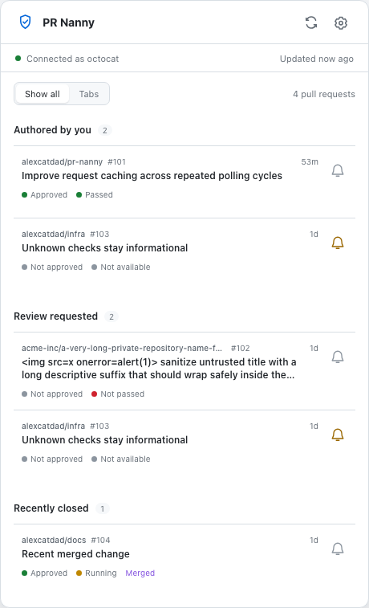
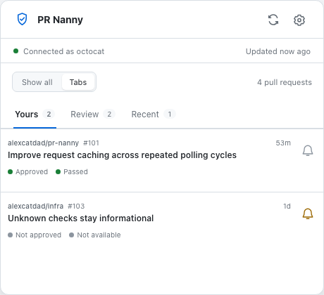
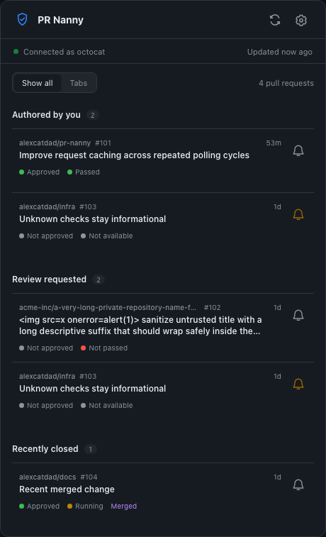
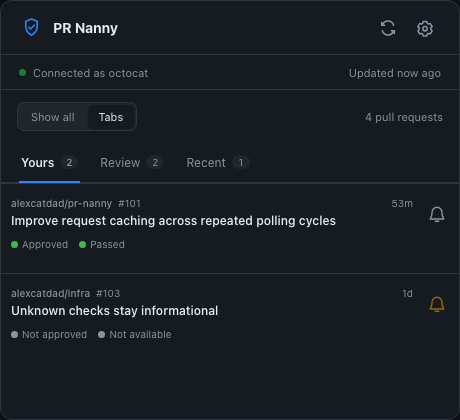
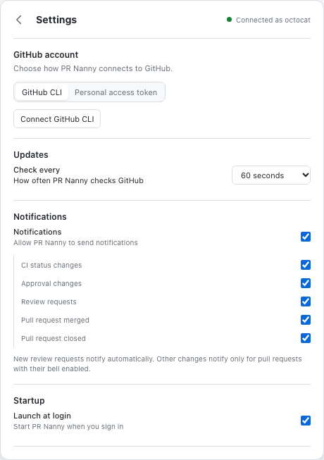
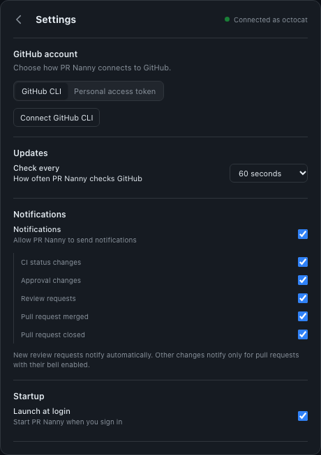

# PR Nanny

PR Nanny is a passive GitHub.com pull-request monitor that lives in the system tray. It reads open pull requests authored by you or requesting your individual or team review, shows their approval and CI summaries, and can send local notifications. It never writes to GitHub or changes subscriptions.

> **0.1.0-rc.1 is a prerelease under qualification.** Release archives are prepared for testing but have not been published as a GitHub Release or Homebrew tap. Cross-platform CI qualification is still pending; the initial foundation validation failed and does not establish platform support. Artifacts are unsigned except for ad-hoc macOS bundle signing, and macOS notarization is unavailable.

## Screenshots

The screenshots use synthetic pull-request fixtures; no GitHub account data is shown.

| Popup: all sections | Popup: tabs |
| --- | --- |
|  |  |
|  |  |

| Settings: light appearance | Settings: dark appearance |
| --- | --- |
|  |  |

## What it does

- Offers **Show all** grouped sections and **Tabs** layouts, sorted by GitHub's most recently updated time. Remembers the layout locally.
- Displays approval as **Approved** or **Not approved**, and CI as **Passed**, **Not passed**, **Running**, or **Not available**. Unknown or incomplete CI data is never shown as a failure.
- Keeps merged or closed PRs in **Recent** for 60 seconds from the actual closure time when GitHub supplies it.
- Polls every 60 seconds by default and supports 30 seconds, 2 minutes, or 5 minutes. Offline and rate-limit states preserve the last fetched rows.
- Supports existing `gh` CLI authentication or a validated PAT held in the operating system credential store. The frontend never handles stored credentials.
- Sends review-request notifications when global notifications and that event are enabled. Other change notifications require that PR's bell to be enabled; bells start off.

CI summaries combine check runs and commit statuses. A failure takes precedence over a pending check; pending checks show Running; all successful, neutral, or skipped checks show Passed. Missing, incomplete, malformed, or unknown results show Not available. Approval means at least one current non-author opinionated review is approved; it is not a merge-readiness calculation.

## Download and install

Archives for `0.1.0-rc.1` are named:

- `pr-nanny-0.1.0-rc.1-darwin-arm64.zip` — macOS 13 or newer, Apple Silicon.
- `pr-nanny-0.1.0-rc.1-windows-x64.zip` — Windows 10/11 x64 with Microsoft Edge WebView2 Runtime.
- `pr-nanny-0.1.0-rc.1-linux-x64.tar.gz` — Linux x64 with glibc 2.39 or newer, GTK4, WebKitGTK 6, and a Secret Service-compatible credential store such as GNOME Keyring or KWallet with Secret Service enabled. Ubuntu 24.04 and current Fedora releases are the target environments.

The artifacts have not been published as release downloads. For now, retrieve the corresponding `package-*` artifact from the CI workflow when that platform's job succeeds. Verify its adjacent `.sha256` file before installing. There is no stable release URL yet.

On macOS, unzip the archive and move `PR Nanny.app` to Applications. The app is ad-hoc signed for bundle integrity, not Developer ID signed or notarized; macOS may require explicit approval to open it.

On Windows, unzip and run `install.ps1` to add a current-user Start Menu shortcut, then launch PR Nanny. The executable is unsigned and may prompt for confirmation. `uninstall.ps1` removes only that shortcut.

On Linux, extract the archive, run `./install.sh` from its extracted directory, and ensure `~/.local/bin` is on `PATH`. The installer adds the app and desktop entry for the current user. Run `./uninstall.sh` in the same directory to remove those application files.

Install scripts do not remove settings or credentials. Homebrew supports macOS and Linux (including WSL); it does not install a native Windows build. No Homebrew tap is published. After real HTTPS release URLs and SHA-256 values exist, `scripts/homebrew.sh` can generate cask and formula templates; it does not publish a tap or invent release values. See [Homebrew installation notes](build/README.md).

## Authentication and permissions

The first launch stays in the tray. Choose **GitHub CLI** to reuse the existing `gh` session, or provide a PAT in Settings. PR Nanny validates a PAT before switching accounts and stores it only in macOS Keychain, Windows Credential Manager, or Linux Secret Service. A credential-store failure does not use a plaintext fallback. `gh` tokens are fetched when needed and are not copied into PR Nanny's credential store.

For a **fine-grained PAT**, grant repository **Pull requests: read**, **Checks: read**, **Commit statuses: read**, and **Metadata: read**; grant organization **Members: read** to discover your teams. Limit repository access to the repositories you want to monitor. Organization policy may require owner approval before a token can read private resources. For a **classic PAT**, private repository access requires the broad `repo` scope, and team discovery requires `read:org`; classic scopes cannot be narrowed to read-only repository permissions. Authorize the classic token for each organization that enforces SAML SSO. See GitHub's [fine-grained token permission reference](https://docs.github.com/en/rest/authentication/permissions-required-for-fine-grained-personal-access-tokens) and [SSO authorization guidance](https://docs.github.com/authentication/authenticating-with-saml-single-sign-on/authorizing-a-personal-access-token-for-use-with-single-sign-on).

## Build from source

Use Go 1.27.2, Node.js 24.19.0, pnpm 11.25.0, and the pinned Wails `v3.0.0-beta.33` dependency. See [CONTRIBUTING.md](CONTRIBUTING.md) for platform prerequisites, tests, and production build commands. Production packages use `-tags production`; do not use development tooling with production builds.

Settings and notification deduplication state are stored as versioned JSON under the OS user config directory; current PR data remains in memory. See [SPEC.md](SPEC.md), [ARCHITECTURE.md](ARCHITECTURE.md), and [SECURITY.md](SECURITY.md) for behavior, data flow, and known limitations.

Ubuntu 24.04+ may need a per-application AppArmor allowance so WebKit can create its sandbox. See [the exact-path profile instructions](build/linux/APPARMOR.md); keep WebKit sandboxing and the system-wide policy enabled.
